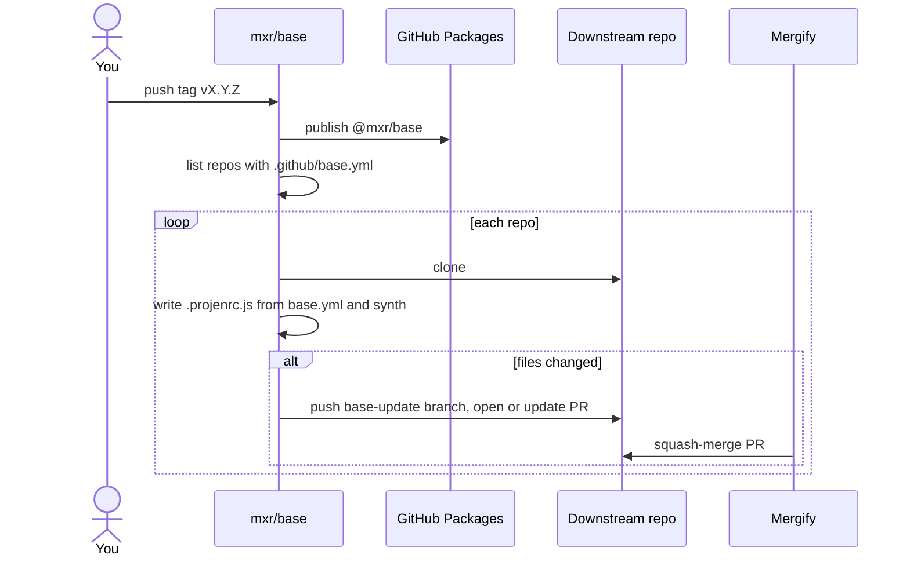
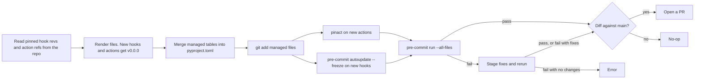

# base

A [projen](https://github.com/projen/projen) external project type that keeps the shared tooling in my personal repos in
sync. Each repo commits one file, `.github/base.yml`, that lists its stacks. base generates the rest: pre-commit hooks,
CI and release workflows, linter config, and Renovate and Mergify config.

## How a sync works

You don't run projen in a downstream repo. Instead, each tag pushed to this repo starts
[`propagate-update.yml`](.github/workflows/propagate-update.yml), which runs
[`propagate-repo.sh`](.github/scripts/propagate-repo.sh) once for each repo that has a `.github/base.yml`.



Synth reuses the repo's existing pins, so a sync changes only what base changed:



Generated files start with a banner that says so. To change one, edit `.github/base.yml` or this repo, not the file.

## Configure a repo

Add `.github/base.yml` to the repo:

```yaml
stack: [python]
opt:
  python:
    min-version: '3.11'
    packaging: wheel
```

Keys under `opt` are kebab-case. The sync converts them to the camelCase options of `BaseProject`.

### Stacks

Some stacks imply others. For example, `python` also turns on `toml`, `github-actions`, and `gitignore`.

| Stack            | Implies                               | Generates                                                                           |
| ---------------- | ------------------------------------- | ----------------------------------------------------------------------------------- |
| `frontend`       | `github-actions`, `gitignore`         | Next.js and Vercel config, CI and release workflows                                 |
| `github-actions` |                                       | zizmor and actionlint hooks, `.github/actionlint.yml`                               |
| `gitignore`      |                                       | gitignore-tidy hook                                                                 |
| `javascript`     | `github-actions`                      | Browser JavaScript without Next.js. No `biome.json`                                 |
| `mirror`         | `github-actions`                      | pre-commit-mirror-maker workflow                                                    |
| `python`         | `toml`, `github-actions`, `gitignore` | ruff, mypy, pyright, and ty hooks, managed `pyproject.toml` tables, tox CI workflow |
| `rust`           | `toml`, `github-actions`, `gitignore` | cargo fmt and clippy hooks, CI workflow, crates.io release workflow                 |
| `shell`          |                                       | shfmt and shellcheck hooks                                                          |
| `sql`            | `toml`                                | sqlfluff hooks and config                                                           |
| `toml`           |                                       | tombi hook                                                                          |
| `typescript`     | `github-actions`, `gitignore`         | `biome.json`, `.gitignore`, and `.gitattributes` for a jsii library                 |

Every repo also gets the default hooks (pre-commit-hooks, pretty-format-yaml, biome, and mdformat),
`.github/renovate.jsonc`, and `.github/mergify.yml`.

### Options

All options are optional unless the description says so.

| Key                                            | Description                                                                                                              |
| ---------------------------------------------- | ------------------------------------------------------------------------------------------------------------------------ |
| `opt.python.min-version`                       | Minimum Python version, such as `'3.11'`. Required for `python`, except with `home-assistant` packaging.                 |
| `opt.python.packaging`                         | `wheel` publishes to PyPI. `home-assistant` releases a HACS integration on GitHub and adds hassfest and HACS validation. |
| `opt.python.home-assistant`                    | `name` and `min-version` for `hacs.json`. Required with `home-assistant` packaging.                                      |
| `opt.python.custom-release`                    | Leave `release.yml` to the repo. Defaults to `false`.                                                                    |
| `opt.python.ci`                                | Generate the tox CI workflow and tox config. Defaults to `true`.                                                         |
| `opt.python.console-script`                    | Add a `<name> = "<module>._main:main"` script and lock with `uv`. Defaults to `false`.                                   |
| `opt.python.run-type-checks-in-github-actions` | Run mypy, pyright, and ty in `typing.yml` instead of pre-commit.ci. Defaults to `false`.                                 |
| `opt.python.tests-dir`                         | Directory that tox runs pytest on. Defaults to `tests`.                                                                  |
| `opt.python.extras.tests`                      | More test directories.                                                                                                   |
| `opt.python.extras.generated`                  | Generated-code directories that the type checkers skip.                                                                  |
| `opt.python.pyproject-path`                    | File to merge `pyproject.toml` tables into, such as a `.mustache` template.                                              |
| `opt.mirror.command`                           | The `pre-commit-mirror` command. Required for `mirror`.                                                                  |
| `opt.mirror.version`                           | pre-commit-mirror-maker commit to install. Defaults to the latest release.                                               |
| `opt.github-actions.custom-managers`           | Renovate custom manager presets, such as `github-actions-versions`.                                                      |
| `opt.pre-commit.exclude`                       | Regexes for the top-level `exclude` in `.pre-commit-config.yaml`.                                                        |
| `opt.mergify.extras.rules`                     | More squash-merge rules, each with a `name` and `conditions`.                                                            |

[`src/base-project.ts`](src/base-project.ts) documents every option.

### Files the repo keeps

base merges into some files instead of owning them:

- `pyproject.toml`: base replaces only the tables and `[project]` keys marked `# generated by mxr/base`.
- `.pre-commit-config.yaml`: hooks that are already pinned keep their `rev`.
- Workflows: actions that are already pinned keep their ref.

## Preview a sync

To see what a local change does to a downstream repo, build a tarball and do a dry run:

```bash
npm ci
REPO=mxr/dotfiles VERSION="$(pwd)/$(npm pack --silent)" LOCAL_TARBALL=1 GITHUB_TOKEN="$(gh auth token)" \
	.github/scripts/propagate-repo.sh
```

The script prints the diff and exits. To try a config before you commit it downstream, set `BASE` to the contents of a
`base.yml`. To sync every repo without a new tag, run the `propagate update` workflow manually.

## Develop

This repo uses itself: its own `.github/base.yml` sets the `shell` and `typescript` stacks.

```bash
npm ci
npm run build
npm test
pre-commit run --all-files
```
